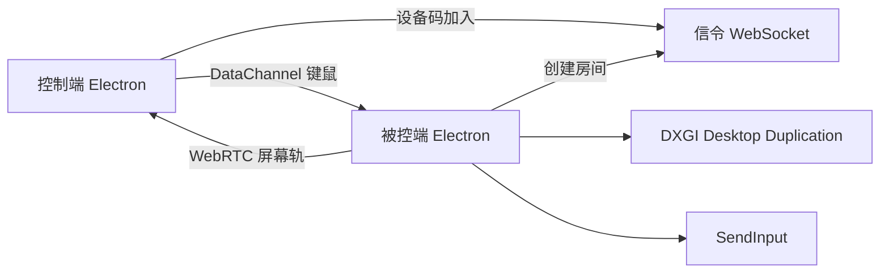

# screen-sharing

屏幕共享。一对一远程桌面骨架，形态接近 ToDesk / 向日葵：被控端展示设备码和可选临时密码，控制端输入设备码发起连接。不是多人会议。

Phase-1 skeleton for a 1:1 remote desktop, in the shape of ToDesk / Sunflower. The controlled host shows a device code and an optional temporary password; the controller types that code to connect. This is not a multi-party meeting.

同一个 Electron 客户端既能当被控端，也能当控制端。Windows 上，主进程用 DXGI Desktop Duplication 采集屏幕，用 `SendInput` 注入键鼠。macOS 不在这次范围内。

The same Electron client plays both roles. On Windows the main process captures with DXGI Desktop Duplication and injects keyboard and mouse with `SendInput`. macOS is out of scope.

## 技术栈 / Stack

- Electron（Windows 优先，macOS 以后）
- WebRTC 屏幕轨 + DataChannel 传键鼠
- 自建轻量 WebSocket 信令，用设备码做房间
- npm workspaces，TypeScript

No secrets belong in this repo. Signaling binds to `127.0.0.1` unless you change it.

## 目录 / Folder map

```
apps/desktop          Electron 客户端（主进程 + preload + 渲染进程）
services/signaling    设备码房间的 WebSocket 信令
packages/protocol     两边共用的信令消息和键鼠事件类型
```

| 路径 | 作用 |
| --- | --- |
| `packages/protocol` | 设备码、临时密码、SDP/ICE、键鼠事件的共享约定 |
| `services/signaling` | 内存房间：创建 / 加入 / 转发 SDP 与 ICE / 离开 |
| `apps/desktop/src/main` | 窗口、DXGI 采集泵、SendInput 注入 |
| `apps/desktop/native/win32` | N-API 插件：Desktop Duplication、`SendInput`、H.264 MFT 探测 |
| `apps/desktop/src/preload` | 渲染进程和主进程之间的窄桥 |
| `apps/desktop/src/renderer` | 设备码界面、WebRTC、DataChannel |

## 安装与运行 / Install and run

需要 Node.js 20 或更高版本。

```bash
npm install
```

`npm install` 会编译 `@screen-sharing/protocol`。同时启动信令和 Electron：

```bash
npm run dev
```

分开启动：

```bash
npm run dev:signaling
npm run dev:desktop
```

只跑信令（不监听文件变化）：

```bash
npm run start:signaling
```

默认地址是 `ws://127.0.0.1:8787`。换端口时两边一起改：

```bash
SIGNALING_PORT=8787 npm run dev:signaling
SIGNALING_URL=ws://127.0.0.1:8787 npm run dev:desktop
```

PowerShell:

```powershell
$env:SIGNALING_PORT="8787"; npm run dev:signaling
$env:SIGNALING_URL="ws://127.0.0.1:8787"; npm run dev:desktop
```

让局域网里的另一台机器连接时，把信令绑到 `0.0.0.0`，并把 `SIGNALING_URL` 设成这台机器的地址。默认只监听本机。

```bash
SIGNALING_HOST=0.0.0.0 SIGNALING_PORT=8787 npm run dev:signaling
```

检查与测试：

```bash
npm test
npm run typecheck
```

### Windows 编译与运行 / Windows build and run

详细说明在 [docs/windows.md](docs/windows.md)。最短路径：

1. 安装 Visual Studio 2022 Build Tools（“使用 C++ 的桌面开发”）和 Windows 10/11 SDK，以及 Python 3。
2. 在仓库根目录执行 `npm install`。
3. 编译原生插件（`npm run dev` / `npm run build` 在 Windows 上也会自动编）：

```bash
npm run build:native -w @screen-sharing/desktop
```

4. `npm run dev`。被控端连上后默认开始共享，状态应显示「采集：DXGI Desktop Duplication（H.264）」。同步编码器打不开时退回不带 H.264 的 DXGI 状态，画面走 JPEG。远程控制默认关闭。被控端勾选「允许远程控制」后，控制端在画面里移动鼠标，被控端光标才会跟着走。

原生插件只在 `win32` 上编译。Linux 上 `npm test` 和 `npm run typecheck` 会跳过它，用来守住坐标映射、扫描码和采集计划。

The native addon builds on win32 only. Linux still runs `npm test` and `npm run typecheck`; those cover coordinate mapping, scan codes, and the capture plan.

### 本地怎么试一条会话

1. 启动 `npm run dev`，窗口左侧会出现 9 位设备码和临时密码。
2. 再开一个客户端（另一个终端执行 `npm run dev:desktop`），或在**同一个窗口**右侧输入自己的设备码和密码，点连接。
3. Windows 上装好原生插件后，右侧是 DXGI 画面。被控端默认开始共享。远程控制默认关闭，被控端勾选「允许远程控制」后，鼠标和键盘才会通过 `SendInput` 作用到被控端。被控端点「停止共享」后，控制端不再显示画面，设备码房间和 WebRTC 连接保持，可以再点「开始共享」。插件还没编出来时，Windows 会退回 Electron 的 desktopCapturer；其他系统仍用 `getDisplayMedia`。两者都失败时才是占位画面。

Linux 上没有 `.node` 插件，主进程会打一行 `[input] win32 addon not loaded; not calling SendInput`，并且不会去调系统输入。

## 字段 / Fields

信令消息走 WebSocket。键鼠不走信令，走 WebRTC DataChannel，标签是 `input`。

| 字段 | 业务含义 | 类型 | 怎么流转 |
| --- | --- | --- | --- |
| `code` | 被控端设备码，也是房间号 | 9 位数字字符串 | 信令在创建房间时生成，被控端展示，控制端填写后 `join-room` |
| `password` | 这个房间的临时准入密码，不是账号密码 | 可选字符串，最长 64 | 被控端设置，只存在信令进程内存里；控制端加入时提交 |
| `role` | `host` 被控端，`controller` 控制端 | 枚举 | 由信令根据「创建」或「加入」分配，客户端不能自报角色 |
| `sdp` | WebRTC 协商描述，信令不解析 | 字符串 | 对端之间原样转发 |
| `candidate` | ICE 候选，信令不解析 | 对象或 `null` | 对端之间原样转发 |
| `from` | 这条 SDP/ICE 是哪一方发出的 | `host` \| `controller` | 信令盖章，客户端不填写 |
| `InputEvent.x` / `y` | 控制端看到的**画面内容区域**上的位置，左上角是 0，范围 0 到 1，已经去掉黑边 | 数字 | 只走 DataChannel。被控端用 DXGI 输出的物理像素原点映射：`pixel = origin + round(t * (size - 1))`，再换成虚拟屏幕上的 `SendInput` 绝对坐标 |
| `InputEvent.code` | 物理按键，对应 `KeyboardEvent.code`（如 `KeyA`） | 字符串 | 只走 DataChannel。不重复发送自动连发，按键按住后的连发交给被控端系统 |
| `deltaX` / `deltaY` | 控制端滚轮的 DOM 增量，`deltaY` 为正表示向下 | 数字 | 只走 DataChannel |
| `session-state.sharing` | 被控端是否正在把画面送出去 | boolean | 只走 DataChannel，被控端发给控制端。`false` 时视频轨换成空轨，不发 `leave`，房间还在。默认 `true` |
| `session-state.control` | 被控端是否允许把键鼠注入本机 | boolean | 只走 DataChannel。`false` 时被控端主进程在 `SendInput` 之前丢掉事件。默认 `false`，只有被控端勾选后才变成 `true` |
| `session-sync` | 控制端向被控端要一份当前共享/控制状态 | 无其它字段 | DataChannel 一打开就发，避免第一条 `session-state` 比监听器更早到达 |

一个房间最多一个被控端、一个控制端。第三个控制端会收到 `room-full`。

## Phase 1 范围 / Scope

现在有：

- 可运行的单体仓库和中英说明
- 内存设备码房间：创建、加入、临时密码、SDP/ICE 转发、离开、断线
- Electron 界面：本机设备码、输入设备码连接、远端画面、断开
- Windows DXGI Desktop Duplication：主进程拿到 BGRA 帧，用同步 Media Foundation H.264 MFT 编成 Annex-B。渲染进程用 WebCodecs 画到 canvas，再交给 WebRTC。编码器打不开时退回 WIC JPEG
- Windows `SendInput`：扫描码键盘、虚拟屏幕绝对坐标的鼠标、滚轮方向已按 DOM 约定转换。远程控制默认关闭，被控端允许后才注入
- 被控端可单独开始/停止共享。停止后控制端不再收画面，房间和连接不断开
- 其它平台仍可用 `getDisplayMedia` 或占位画面把会话跑起来

现在没有：

- 把 H.264 留在 GPU 上，并用硬件异步 MFT 直接送进 RTP。现在仍会解码到 canvas，由 Chromium 再编码一次。下一步写在 [docs/windows.md](docs/windows.md)
- macOS
- TURN / coturn（跨网穿透）
- 账号、设备码防爆破、密码哈希、房间持久化
- 剪贴板、文件传输、多显示器切换策略（坐标映射已按多屏虚拟桌面计算，采集默认主显示器）
- 多人会议

## 扩展点 / Where to plug in

在仓库里搜这些标记：

| 标记 | 位置 | 要接什么 |
| --- | --- | --- |
| DXGI 采集 | `apps/desktop/native/win32`、`src/main/dxgi-host.ts` | 已接上。渲染进程开了沙箱，不能加载 `.node` |
| `SendInput` | `src/main/input-injection.ts`、`native/win32/src/send_input.cc` | 已接上。DataChannel 的 `InputEvent` 经 preload 进主进程 |
| H.264 | `native/win32/src/h264_encoder.cc`、`src/renderer/h264-preview.ts` | 同步 MFT 已接上。下一步是 GPU NV12 和不再二次编码的 RTP |
| `TODO(turn)` | `apps/desktop/src/renderer/peer-session.ts` | 自建 coturn。不要把长期凭证提交进仓库 |
| `TODO(macos)` | `capture-plan.ts`、`input-injection.ts` | 以后的 ScreenCaptureKit 和 CGEvent |



`screen_sharing_win32.node` 已经列在 `apps/desktop/scripts/bundle.mjs` 的 `external` 里。esbuild 不能打包 `.node`，主进程按绝对路径加载。

## 信令进程模型 / Signaling notes

房间表在 `services/signaling/src/rooms.ts`，进程重启后设备码全部失效。这是 Phase 1 的刻意选择。密码目前明文放在内存里，只做长度相等时的逐字符比较；上线前需要改成限流、哈希，以及设备码防猜。

日志不打印密码和 SDP 正文。
